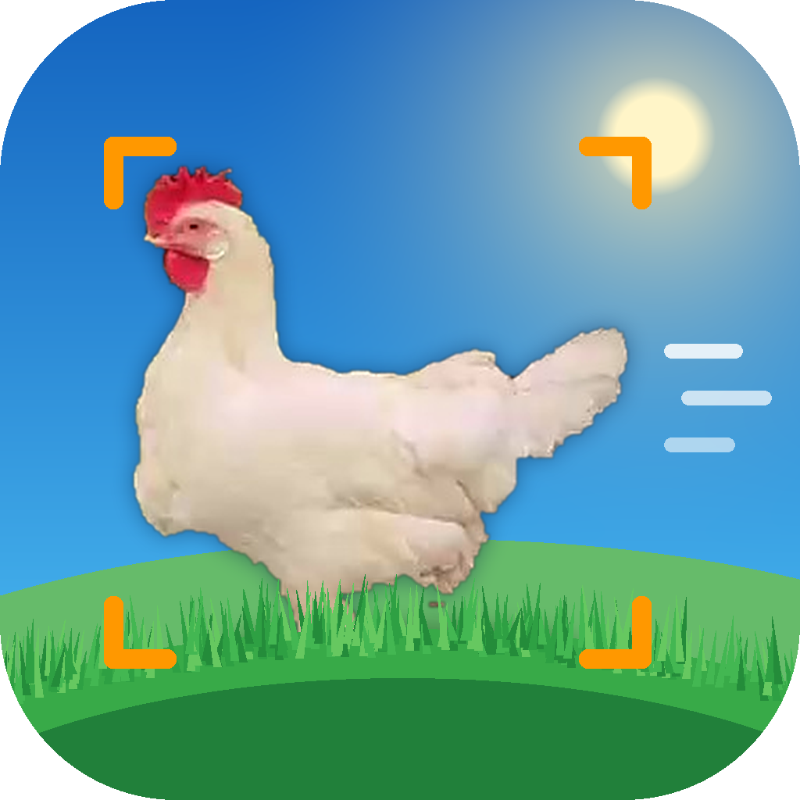
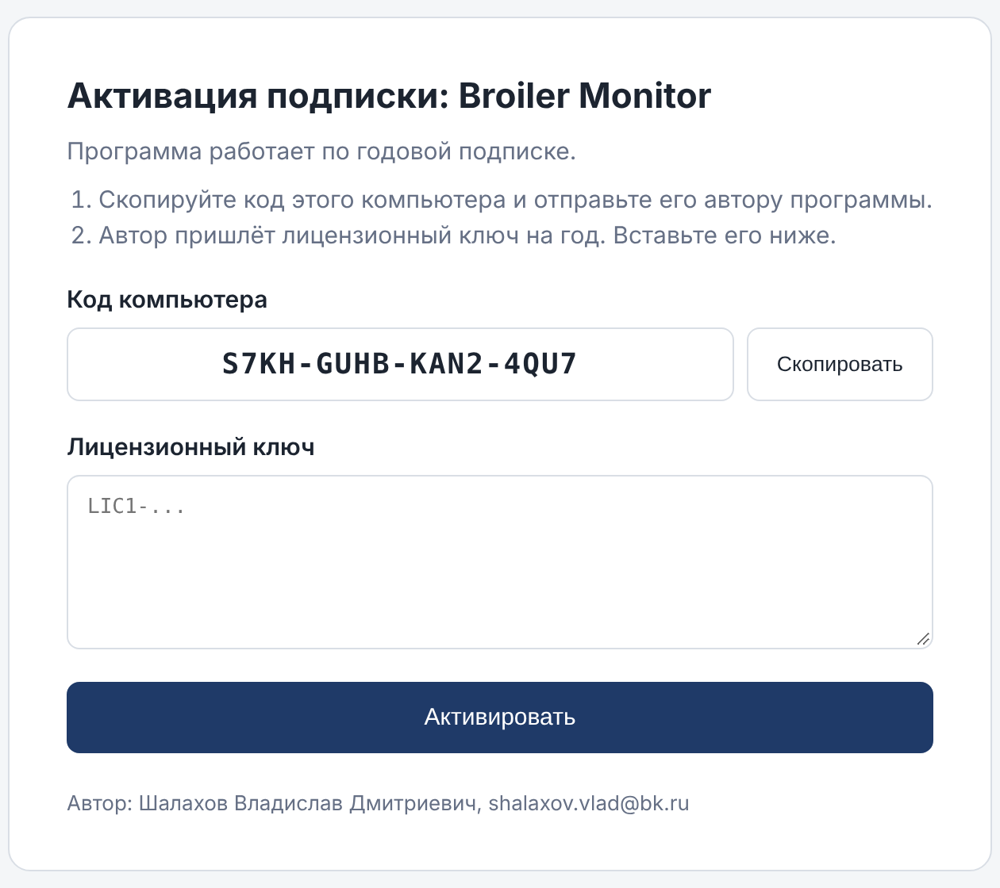

<h1 align="center">Broiler Monitor</h1>

Программа для оценки двигательной активности цыплят-бройлеров по видеозаписи или по изображению с камеры в реальном времени.

Нейросетевая модель находит птиц на кадре, программа строит траекторию каждой птицы и рассчитывает скорость движения и долю активных птиц в группе. Анализ можно ограничить рабочей зоной, обведя её на кадре, чтобы в расчёт не попадали кормушки, поилки и оборудование. Для видеозаписей есть режим «Обводка»: по контуру птицы определяются длина, ширина и площадь тела, а также состояние (покой, движение на месте, перемещение).

По окончании анализа формируются протокол PDF с показателями (M ± SD, 95 % ДИ), рисунки 300 dpi для публикаций и таблицы CSV.

Программа работает без интернета. Видеозаписи и результаты остаются на компьютере пользователя.

## Скачать

| Компьютер | Файл |
|---|---|
| Windows 10 и 11 (64-разрядная) | [BroilerMonitor_Setup.exe](https://github.com/sudmar1n/BroilerMonitor/releases/latest/download/BroilerMonitor_Setup.exe) |
| Mac с процессором Apple Silicon (M1 и новее) | [BroilerMonitor-mac-arm64.dmg](https://github.com/sudmar1n/BroilerMonitor/releases/latest/download/BroilerMonitor-mac-arm64.dmg) |
| Руководство по установке и активации | [Broiler_Monitor_Rukovodstvo_po_ustanovke.pdf](https://github.com/sudmar1n/BroilerMonitor/releases/latest/download/Broiler_Monitor_Rukovodstvo_po_ustanovke.pdf) |

Все версии: раздел [Releases](https://github.com/sudmar1n/BroilerMonitor/releases).

## Установка

**Windows.** Запустите `BroilerMonitor_Setup.exe`. Если появится окно «Система Windows защитила ваш компьютер», нажмите «Подробнее», затем «Выполнить в любом случае». Права администратора не нужны.

**macOS.** Откройте `BroilerMonitor-mac-arm64.dmg` и перетащите значок программы в папку «Applications». При первом запуске macOS сообщит, что не удалось проверить программу: нажмите «Готово», откройте «Системные настройки» → «Конфиденциальность и безопасность» и нажмите «Всё равно открыть».

Подробно, с пояснением каждого шага, установка описана в [руководстве](https://github.com/sudmar1n/BroilerMonitor/releases/latest/download/Broiler_Monitor_Rukovodstvo_po_ustanovke.pdf).

## Подписка

Программа работает по годовой подписке. При первом запуске открывается окно активации с кодом компьютера.

1. Нажмите «Скопировать» и отправьте код на shalaxov.vlad@bk.ru, указав название хозяйства или организации.
2. В ответ придёт лицензионный ключ на год (строка, начинающаяся с `LIC1-`).
3. Вставьте ключ в окно и нажмите «Активировать».

Ключ вводится один раз. За 30 дней до окончания срока программа напомнит о продлении. Результаты анализов при окончании подписки сохраняются.

## Требования

| | Windows | macOS |
|---|---|---|
| Система | Windows 10, 11 (x64) | macOS 12 и новее |
| Процессор | 4 ядра и более | Apple M1, M2, M3, M4 |
| Память | от 8 ГБ, лучше 16 ГБ | от 8 ГБ, лучше 16 ГБ |

Источники видео: видеофайлы MP4, MOV, AVI, MKV; камера компьютера (встроенная или USB); IP-камеры по RTSP и HTTP (Hikvision, Dahua и др.).

## Автор

Шалахов Владислав Дмитриевич, shalaxov.vlad@bk.ru

Исходный код программы закрыт. В этом репозитории размещаются только установочные файлы и документация.
